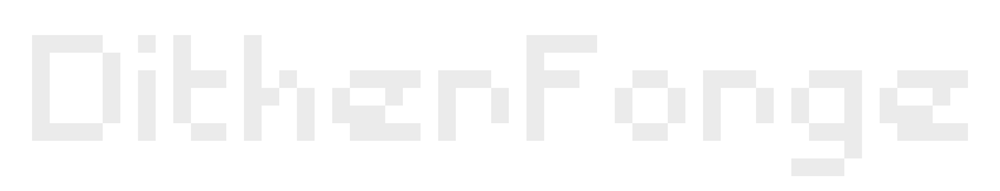

<p align="center">
  
</p>

<h3 align="center">Dithering, ASCII & Retro Post-Processing Suite</h3>

DitherForge is a standalone, cross-platform studio for dithering images, video, and keyframe animations. Built with React 19, TypeScript, Zustand, Web Workers, and an optional Tauri 2 + Rust native backend, it combines **148 dithering & ASCII algorithms**, **42 stackable post-effects**, **19 built-in palettes**, **batch ZIP processing**, and **`.ditherforge` project files**.

🌐 **Live demo:** https://springdallies.github.io/DitherForge/

---

## Key Features

### 148 Dithering & ASCII Algorithms
Categorized, searchable, and navigable with `<` / `>` stepping, favorites, and progressive parameter disclosure:
- **Core Engine (84 algorithms)** across **Basic**, **Error Diffusion**, **Ordered**, **Pattern**, **Polygon**, **Glitch Effects**, and **Special**
- **Legacy Ported Algorithms (40 algorithms)** with bit-identical determinism & alpha preservation
- **Dedicated ASCII Engine (24+ modes)** with vector/raster glyph rendering, custom character sets, ink-density calibration, and dedicated ASCII post-effects

### Color & Palette System
- **19 Built-in Palettes** (Monochrome, GameBoy, Amber CRT, Cyberpunk, CGA, C64, PICO-8, Nordic, Vaporwave, Solar, EGA, Sepia, Spectrum, Macintosh 1984, and more)
- **Live Palette Extraction**: K-Means and Median Cut color extraction directly from the active image
- **Custom Swatch Editor**: Per-swatch color picker, lock/unlock, shuffle, invert, flip, palette depth control, and `.json` / `.hex` import & export

### 42 Reorderable Post-Effects & Chain Presets
Stack, reorder, solo/toggle, and blend effects across 6 categories (**CRT**, **Film**, **Glitch**, **Print**, **Color**, **Texture**) with per-effect opacity and blend modes (`normal`, `screen`, `multiply`, `overlay`, `add`), plus named chain presets (*Trinitron 1994*, *Photocopy Zine*, *Super 8*, *GameBoy Pocket*, *VHS Rental*).

### Video, Keyframe Timeline & Animation
- **Still & Animated Modes**: Convert any image into a multi-track keyframe animation with easing curves
- **Video Import**: MP4 / WebM / MOV / GIF playback with **9 CRT temporal noise profiles**
- **Native FFmpeg Integration** (Tauri desktop) + in-browser GIF / WebM / frame-sequence ZIP export

### Batch Processing & Project Persistence
- **Batch Processing**: Apply your active dither, tweaks, palette, ASCII mode, and post-effects stack across multiple images and download a single `.zip`
- **Project Files (`.ditherforge`)**: Save and reload compact projects (including embedded source image and full editor state) via **File → Save Project / Open Project** (`Ctrl+S`) or drag-and-drop

### Studio UI, Colour Schemes & Swappable Skins
- **14 Colour Schemes**: Light Pro, Dark, Dark Pro, Nord, Evergreen, Gruvbox, Catppuccin Mocha, Tokyo Night, Kanagawa Wave, Rosé Pine, Dracula, Monokai Pro, Solarized Dark, One Dark
- **Swappable UI Skin Architecture**: Semantic `data-df-*` labels on every region, section, modal, and control plus `data-ui-skin` CSS entry points ([`docs/UI_THEMING_AND_SKINS.md`](./docs/UI_THEMING_AND_SKINS.md))
- **Viewport Controls**: Pointer-centered zoom, pan, `1:1`, fit-to-viewport, draggable Before/After split compare, full application-level Undo/Redo (`Ctrl+Z` / `Ctrl+Shift+Z`), and configurable 2D / 3D anvil logo

---

## Installation & Getting Started

### Prerequisites

| Tool | Version Requirement | Notes |
| :--- | :--- | :--- |
| **Node.js** | `>= 18.0.0` (LTS recommended) | Includes `npm` |
| **Rust & Cargo** | `>= 1.75.0` (stable) | Required only for Tauri 2 native desktop builds |

#### System Packages for Desktop App (Tauri v2)

<details>
<summary><b>Linux (Ubuntu / Debian / Mint)</b></summary>

```bash
sudo apt-get update && sudo apt-get install -y \
  libwebkit2gtk-4.1-dev \
  build-essential \
  curl \
  wget \
  file \
  libxdo-dev \
  libssl-dev \
  libayatana-appindicator3-dev \
  librsvg2-dev
```
</details>

<details>
<summary><b>Linux (Fedora / RHEL)</b></summary>

```bash
sudo dnf install -y \
  webkit2gtk4.1-devel \
  openssl-devel \
  curl \
  wget \
  libappindicator-gtk3-devel \
  librsvg2-devel
```
</details>

<details>
<summary><b>Linux (Arch / Manjaro)</b></summary>

```bash
sudo pacman -S --needed \
  webkit2gtk-4.1 \
  base-devel \
  curl \
  wget \
  openssl \
  libappindicator-gtk3 \
  librsvg
```
</details>

<details>
<summary><b>macOS</b></summary>

```bash
xcode-select --install
```
</details>

<details>
<summary><b>Windows</b></summary>

- Install [Visual Studio C++ Build Tools](https://visualstudio.microsoft.com/visual-cpp-build-tools/) (select "Desktop development with C++").
- Microsoft Edge WebView2 (included by default on Windows 10/11).
</details>

---

### 1. Clone & Install

```bash
git clone https://github.com/SpringDallies/DitherForge.git
cd DitherForge
npm install
```

### 2. Web Application

```bash
# Development server (http://localhost:5173/)
npm run dev

# Production build & local preview (http://localhost:8080/)
npm run build
npm run serve
```

### 3. Desktop Application (Tauri v2)

```bash
# Development mode
npm run tauri dev

# Production installer / bundle
export APPIMAGE_EXTRACT_AND_RUN=1   # Linux containers / no FUSE
npm run tauri build
```

---

## Testing & Verification

```bash
# TypeScript type-check
npx tsc --noEmit

# Full test suite (legacy algorithms, batch video, effects, presets, undo/redo)
npm test

# Bit-identical golden tests
npm run test:golden

# Verify frozen engine SHA-256 hashes & feature inventory
npm run engine:verify
npm run inventory:check
```

---

## Documentation

- [`docs/UI_THEMING_AND_SKINS.md`](./docs/UI_THEMING_AND_SKINS.md) — UI skinning architecture, `data-df-*` component labels, and CSS token reference.
- [`docs/ENGINE_PARITY.md`](./docs/ENGINE_PARITY.md) — JS vs Rust engine parity, IPC routing, and Tauri command surface.
- [`FEATURE_INVENTORY.md`](./FEATURE_INVENTORY.md) — Audited feature inventory and 84-algorithm registry map.
- [`SPEC_LOG.md`](./SPEC_LOG.md) — Mathematical formulations and academic citations.
- [`CHANGELOG.md`](./CHANGELOG.md) — Chronological release and development history.
- [`src/docs/ALGORITHM_REFERENCE.md`](./src/docs/ALGORITHM_REFERENCE.md) — Full in-app algorithm reference manual.

---

## License
Dual-licensed under MIT and Apache-2.0.
