# DitherForge


<p align="center">
  
</p>

<h3 align="center">FOSS Dithering Suite</h3>
DitherForge is a standalone, cross-platform app for dithering images, video, and animation. It ships with 63 original and public-domain dithering algorithms, works directly in native color space, and lets you stack post-effects on top of your results. There's CRT-style temporal noise, vector contour export, and real Unicode character grids. It's inspired by ditherboy.

---

## What's Inside

### 63 Dithering Algorithms (Public-Domain & Clean-Room)

**Error diffusion (15)** — Floyd–Steinberg, Atkinson, Jarvis–Judice–Ninke, Stucki, Burkes, Sierra Three-Row, Sierra Two-Row, Sierra Lite, Stevenson–Arce, Fan Adaptive, Shiau–Fan Balanced, Shiau–Fan 2, False Floyd–Steinberg, Minimized Average Error (Oatley), and Dynamic Serpentine Lattice.

**Ordered dithering (5)** — Bayer 2×2, 4×4, 8×8, and 16×16, plus Clustered Dot (Screened Halftone).

**Pattern dithers (8)** — Checkered, Horizontal Lines, Vertical Lines, Interlocking Crosshatch, Diagonal 45° Hatch, Concentric Diamond, Woven Basket, and Hexagonal Stochastic Stipple.

**Glitch & signal synthesis (17)** — Scanline Jitter, Color Channel Chromatic Offset, Directional Pixel Sorting, Digital Compression Artifacts, Interlacing Field Tear, CRT Phosphor Bloom, Bit-Depth Crush, VHS Tracking Noise, Bad RAM Nibble Inversion, Sinusoidal Wave Warp, Quantization Step Slicing, Diagonal Matrix Rake, Analog Static Snow, Sync Pulse Hold Collapse, Edge Ringing & Feedback, YUV 4:1:1 Degradation, and Moiré Interference.

**Special & stochastic (16)** — Fixed Bi-Level Cutoff, Uniform White Noise, Void-and-Cluster Blue Noise, Gaussian Normal Distribution, Perlin Gradient Lattice, Riemersma Hilbert Space-Curve, Ostromoukhov Variable Diffusion, Triangular PDF (TPDF), Dynamic Companding (A-Law), Hexagonal Spatial Lattice, Sobel Silhouette Preserving, Laplacian High-Pass, Directional Gradient, Voronoi Cellular Stipple, Unsharp Diffusion Quantizer, and Quantum Micro-Stipple.

**Bespoke (1)** — **Ignition Glow** (Bespoke Dither Bloom). It reads local dot density and edge contrast, then bleeds in a phosphor-style halo that doesn't smother fine detail.

**Temporal (1)** — **Temporal Kinetic Dither**, which phase-shifts continuously for animated media.

### Color Handled Natively

Color isn't bolted on as a pre- or post-filter. The error diffusion and ordered threshold loops measure distances straight in 3D Rec. 709 luminance-weighted RGB space, with up to 32 depth iterations per palette and live swatch remapping.

### Reorderable Post-Effects Stack

Add effects with the "+" menu and drag them into whatever order you want:

- Ignition Glow
- Separable Blur / Sharpen
- Chromatic Aberration
- JPEG Artifact Simulation
- CMYK Newspaper Halftone (dot angle, size, and shape)
- CRT Scanlines
- Pixelate
- Curves & Levels
- Optical Vignette Falloff

### Video & Animation Timeline

- Interactive scrubber with play/pause, loop, and FPS options (12, 24, 30, 60).
- **9 CRT temporal noise profiles**: Grain, Static, Scanline Drift, Vertical Drift, Pulse, Flicker, Wave, Shimmer, and Chaos.
- One-click **Animate Still** converter.
- Real-time MP4/WebM stream recording.

### 9 Export Formats

- **PNG** — lossless raster for print
- **JPG** — compressed raster for the web
- **WebP** — modern lightweight compression
- **SVG** — vector contours with grouping, traced via Marching Squares for pen plotters and laser cutters
- **TXT** — true character grids: ASCII (` .:-=+*#%@`), Unicode blocks (` ░▒▓█`), and 2×4 Braille matrices (`U+2800..U+28FF`)
- **MP4 / WebM** — recorded animated dither streams
- **GIF** — animated retro sequences
- **Frame Sequence** — exported PNG frames
- **Clipboard** — copy straight to Photoshop, Figma, or Discord

### The Studio UI

- Canvas preview with smooth zoom, pan, 1:1 view, and fit-to-window
- **Before/After toggle** and a **draggable split comparison slider**
- 6 themes: Dark Pro, CRT Phosphor Green, Cyberpunk Neon, GameBoy Olive, Retro Mac 1984, and Vaporwave Pink
- Preset manager with 10 built-in presets and JSON save/load for your own
- Full in-app **Algorithm Reference** — over 1,500 lines of documentation

---

## Getting Started

### Web App (Vite + React + TypeScript)

Start the dev server on port 5173:

```powershell
npm install
npm run dev
```

Then open `http://localhost:5173/app.html`.

To build and serve the production bundle on port 8080:

```powershell
npm run build
npm run serve
```

Then open `http://localhost:8080/app.html`.

### Desktop App (Tauri 2 + Rust)

Run it natively:

```powershell
# From the DitherForge directory
npm install
npm run tauri dev
```

To package a release (`.exe` on Windows, `.dmg` on macOS, `.AppImage` on Linux):

```powershell
npm run tauri build
```

---

## Documentation

- [`SPEC_AND_CLEAN_ROOM_LOG.md`](./SPEC_LOG.md) — algorithm provenance, and mathematical formulations
- [`src/docs/ALGORITHM_REFERENCE.md`](./src/docs/ALGORITHM_REFERENCE.md) — the full technical manual: every algorithm, parameter sensitivity, and visual trade-offs

---

## License

Dual-licensed under MIT and Apache-2.0.
